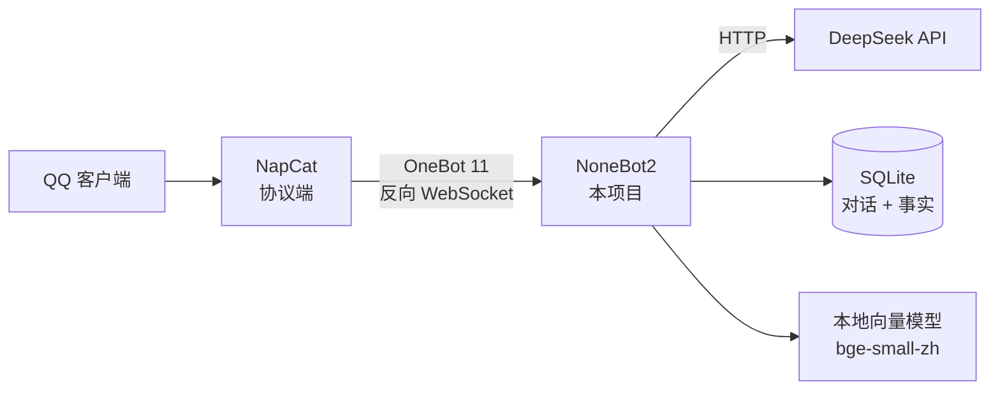

# 鲸鱼娘 QQ 机器人

把 DeepSeek 接进 QQ，用鲸鱼娘的口吻聊天。带长期记忆，全部跑在本地。

不需要服务器，不需要公网 IP，数据都在自己硬盘上。

## 特性

- **人设可配置** —— 人格、口头禅、说话长度都在一个文件里，改完重启即生效
- **长期记忆** —— 对话存 SQLite，重启不失忆；本地向量检索，能想起很久以前聊过的事
- **记忆可管理** —— `/记忆` 查看、`/忘掉` 删除、`/记忆清空` 重置，记错了能纠正
- **省 token** —— prompt 分三层（人设 / 事实 / 对话），前两层稳定命中 DeepSeek 上下文缓存
- **纯本地** —— 向量模型本地跑，不额外花 token
- **零服务器成本** —— 跑在自己的电脑上，不租云主机

## 架构



请求组装顺序（前三段稳定以命中缓存）：

```
[system]  人设 prompt        ← 永不改动，缓存命中
[system]  已知事实           ← 每天最多变一次，大部分命中
[system]  相关往事           ← 向量召回，每轮变
[user/assistant] 最近对话    ← 每轮变，全价计费
[user]    当前消息
```

## 快速开始

### 前置要求

| 项 | 版本 |
|---|---|
| Python | 3.10+ |
| Node.js | 18+（NapCat 需要） |
| QQ | NT 版（9.9.x，不是旧版 9.7） |
| DeepSeek API Key | [platform.deepseek.com](https://platform.deepseek.com) 申请 |

### 1. 安装依赖

```bash
git clone https://github.com/zelatu/my_dsbot.git
cd my_dsbot

python -m venv .venv
.venv\Scripts\activate        # Windows
# source .venv/bin/activate   # macOS / Linux

pip install -r requirements.txt
```

> `websockets` 是必须的。缺了它 WebSocket 握手会返回 404，NapCat 日志里会显示
> `No supported WebSocket library detected`。

### 2. 配置

```bash
copy .env.example .env        # Windows
cp .env.example .env          # macOS / Linux
```

编辑 `.env`，至少填上：

```ini
DEEPSEEK_API_KEY=sk-你的key
```

**先不接 QQ 也能测人设**：

```bash
python test_deepseek.py        # 单次
python test_deepseek.py -i     # 交互对话，调人设用这个
```

看到鲸鱼娘回话，说明模型这一侧已经通了。

### 3. 安装 NapCat

NapCat 是 QQ 的协议端，负责登录账号、收发消息。

1. 装 PC 版 QQ（**NT 版**）：https://im.qq.com
2. 下载 NapCat：https://github.com/NapNeko/NapCatQQ/releases
   - Windows 选 `NapCat.Shell.zip`（已有 Node）或 `NapCat.Shell.Windows.Node.zip`（自带 Node）
   - **Windows 10 用户**：启动用 `launcher-win10.bat`，不是 `launcher.bat`
3. 运行启动器，浏览器打开 WebUI（默认 `http://127.0.0.1:6099/webui`，token 见启动日志）
4. 扫码登录

### 4. 连接

本项目在 `127.0.0.1:8080` 监听，等 NapCat 主动连过来。

在 NapCat 的 WebUI → 网络配置 → 新建 **WebSocket 客户端**（反向 WS）：

| 项 | 值 |
|---|---|
| URL | `ws://127.0.0.1:8080/onebot/v11/ws` |
| Token | 留空（与 `.env` 的 `ONEBOT_ACCESS_TOKEN` 一致） |

### 5. 运行

```bash
python bot.py
```

看到下面这行就成功了：

```
OneBot V11 | Bot 123456789 connected
```

## 配置项

`.env` 里的全部可配置项：

| 变量 | 默认值 | 说明 |
|---|---|---|
| `DEEPSEEK_API_KEY` | — | **必填** |
| `DEEPSEEK_MODEL` | `deepseek-chat` | 可选 `deepseek-flash`（更快更便宜） |
| `DEEPSEEK_API_BASE` | `https://api.deepseek.com/v1` | 兼容 OpenAI 协议的接口均可 |
| `WHALE_TRIGGER_PREFIX` | `鲸鱼` | 群聊里以这个词开头也会触发 |
| `WHALE_MAX_HISTORY` | `10` | 每次带多少条历史（一问一答算 2 条） |
| `WHALE_TEMPERATURE` | `1.1` | 越高越跳脱 |
| `WHALE_MEMORY_ENABLED` | `true` | `false` 退回内存模式（重启失忆） |
| `WHALE_ADMIN_QQ` | 空 | 允许在群聊用 `/记忆` 的 QQ 号，逗号分隔 |

## 使用

- **私聊**：发什么都回
- **群聊**：`@机器人 你好` 或以 `鲸鱼` 开头（可配置）
- **重置对话**：发 `重置` 或 `/reset`

管理指令（仅 `WHALE_ADMIN_QQ` 或私聊可用）：

| 指令 | 作用 |
|---|---|
| `/记忆` | 查看记住了什么 |
| `/忘掉 香菜` | 删除相关记忆 |
| `/记忆清空` | 清空当前会话记忆 |

## 记忆系统

### 数据

| 存储 | 位置 | 内容 |
|---|---|---|
| 对话与事实 | `data/whale.db` | SQLite，含全部原始对话 |
| 向量模型 | `models/hf/` | 91MB，首次运行自动下载 |

两者都在 `.gitignore` 里，不会被提交。

### 提炼事实

画像不是自动生成的，需要跑提炼脚本：

```bash
python distill.py            # 有新料才提炼（≥30 条新对话）
python distill.py --force    # 强制提炼
python distill.py --list     # 查看各会话待提炼数量
```

建议配一个每天一次的定时任务，脚本会自己判断要不要真干活——没有新对话时耗时 <50ms、不产生 token 费用。

提炼时会区分事实类型：

| 类型 | 例子 | 处理 |
|---|---|---|
| 长期 | 不吃香菜、猫叫豆豆 | 永久保留 |
| 短期 | 在准备面试 | 30 天后自动失效 |
| 一次性 | 今天心情不好 | 不写入 |

### 检索

本地 `bge-small-zh-v1.5`（512 维）+ numpy 余弦相似度暴力搜索。一万条对话约 15MB，检索 <10ms。

阈值 0.35。实测「我喜欢吃什么」↔「我最喜欢吃白米饭」相似度 0.697，↔「今天天气不错」0.297（被过滤）。

向量化失败不影响正常对话，只是那条搜不到。

## 表情包

回复会配一张梗图。不是随机发，而是按情绪匹配。

### 怎么工作

模型在回复末尾可以加一个情绪标记（对方看不到，会被程序移除）：

```
[emo:happy]  [emo:angry]  [emo:sad]  [emo:speechless]
[emo:surprised]  [emo:smug]  [emo:shy]
```

- **有标记** → 从该情绪的图库里随机挑一张（最准）
- **无标记** → 按 `WHALE_EMO_PROB` 概率触发向量检索兜底
- **都不中** → 不发表情，宁可不发也不发不相关的

### 准备图库

```bash
python tools/fetch_memes.py              # 抓全部 41 页（2452 张）
python tools/fetch_memes.py --pages 20   # 只抓前 20 页
python tools/label_memes.py              # 给图打情绪标签
```

图库来自 [梗鲸 aigengtu.com](https://aigengtu.com)——蓝色大肥鱼表情包档案馆。
脚本会自动过滤敏感内容，抓完的图存在 `assets/emo/`，索引在 `assets/emo_index.json`。

### 加自己的图

1. 把图放进 `assets/emo/`，命名成数字（如 `9001.webp`）
2. 在 `assets/emo_index.json` 里加一条：

```json
{"id": "9001", "category": "自制", "caption": "无语翻白眼表情包", "emotion": "speechless"}
```

`emotion` 可选，不填就只参与向量检索。

### 已知限制

情绪标签是靠台词里的关键词规则打的，覆盖率约 14%（51/368），其余靠向量兜底。
向量匹配对这批梗图的效果一般——相似度普遍挤在 0.46~0.55，区分度低。
想提升的话，可以给更多图补 `emotion` 字段。

## 项目结构

```
├── bot.py                      # 入口
├── distill.py                  # 离线提炼事实
├── test_deepseek.py            # 不接 QQ 单测人设
├── plugins/whale_chat/
│   ├── __init__.py             # 消息收发、指令、表情合成
│   ├── persona.py              # 人设 prompt（改这里调性格）
│   ├── storage.py              # SQLite 读写
│   ├── embedding.py            # 本地向量化
│   ├── memory.py               # 上下文组装、向量召回
│   └── emoji.py                # 表情包检索
├── tools/
│   ├── fetch_memes.py          # 抓取表情包图库
│   └── label_memes.py          # 给图打情绪标签
├── data/                       # 运行时生成，已忽略
├── models/                     # 模型缓存，已忽略
└── assets/emo/                 # 表情包图库，已忽略
```

## 常见问题

**NapCat 报 `Unexpected server response: 404`**
缺 WebSocket 库。`pip install websockets`。日志里同时会有 `No supported WebSocket library detected`。

**NapCat 显示已连接，但机器人不回话**
群聊必须 @ 或触发词开头，普通闲聊不回（防刷屏和烧 token）。看 bot 日志有无报错。

**`DeepSeek 返回 401`**
Key 错了或失效。

**`余额不足`**
DeepSeek 账户没钱了。

**重启后上下文没了**
检查 `WHALE_MEMORY_ENABLED` 是否为 `true`，以及 `data/whale.db` 是否可写。

**Windows 下双击 .bat 中文乱码**
`.bat` 文件必须存为 GBK 或纯 ASCII，UTF-8 中文会被 cmd 按 GBK 解析成乱码并破坏语法。

**模型下载失败**
设置 `HF_ENDPOINT=https://hf-mirror.com` 和 `HF_HUB_DISABLE_XET=1`。
后者很关键——新版 huggingface_hub 默认走 Xet 协议，镜像站不支持，会报 `401 Unauthorized`。

## 想 24 小时在线

当前方案依赖电脑开机。需要常驻的话，把整个目录搬到一台不关机的机器上（云服务器 / 旧笔记本 / NAS）：

- 国内轻量 2 核 2G 起步（NapCat 吃内存，1 核 1G 容易 OOM）
- 用 systemd 或 Docker 守护两个进程：NapCat 和 `bot.py`
- **不需要域名、不需要备案**（只主动外连，不对外提供服务）
- 务必把 `ONEBOT_ACCESS_TOKEN` 改成强随机串，`HOST` 保持 `127.0.0.1`

## 免责声明

- 本项目使用 **NapCat** 等非官方协议端接入 QQ，**违反腾讯 QQ 用户协议，存在账号被封禁的风险**。请务必使用小号，不要使用主账号。
- 本项目与 DeepSeek（深度求索）官方无任何关联，不代表官方立场。
- 「鲸鱼娘」形象版权归原作者所有，本项目仅提供文字人设 prompt，不包含任何图像素材。
- 仅供个人学习与技术研究使用，请勿用于商业用途或大规模自动化操作。

## 许可

MIT
